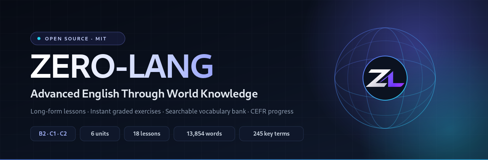

# ZERO-LANG

> **Advanced English through world knowledge.** A free, open-source B2–C2 English platform built around long-form reading, real vocabulary and graded exercises — not streaks, cartoons or chatbot upsells.

[](LICENSE)
[](https://nextjs.org/)
[](https://www.typescriptlang.org/)
[](https://supabase.com/)
[](https://tailwindcss.com/)

---

## Why this exists

Most advanced English material is either **too easy** (endless B1 grammar drills) or **too shallow** (three-paragraph "articles" with a five-word glossary). ZERO-LANG is built for the learner who can already hold a conversation and now needs to read, argue and write at a professional level.

Every lesson teaches English *through* a serious subject: climate policy, transformer architecture, moral philosophy, inequality, immunology, media manipulation. You finish a lesson knowing both the language **and** the argument.

**The numbers in this repository:**

| | |
|---|---|
| **6** units | **18** long-form lessons |
| **13,854** words of reading | **245** key vocabulary terms |
| **108** graded questions | **3** CEFR levels: B2, C1, C2 |

No mock data. Every number above is generated from the content modules in [`scripts/content/`](scripts/content) and stored in Postgres.

---

## The library

| Unit | Level | Lessons | Words | What you actually learn |
|---|---|:---:|---:|---|
| 🌍 **Climate Science & Policy** | B2 | 3 | 2,604 | Feedback loops, mitigation vs. adaptation, carbon pricing, climate risk communication |
| 🤖 **Artificial Intelligence Fundamentals** | C1 | 3 | 2,275 | Supervised/self-supervised/RL paradigms, attention and transformers, alignment debates |
| 🤔 **Philosophy & Ethics** | C2 | 3 | 2,338 | Consequentialism, deontology, virtue ethics, Rawlsian justice, moral luck |
| 📈 **Global Economics & Inequality** | C1 | 3 | 2,320 | Institutions vs. geography, Gini and top income shares, trade and supply chains |
| 🔬 **Science & Medicine** | B2 | 3 | 2,116 | RCTs and bias, innate vs. adaptive immunity, antimicrobial resistance |
| 📡 **Media, Truth & Information** | C2 | 3 | 2,201 | Attention economy, misinformation mechanisms, rhetoric and framing |

Each lesson contains:

- **Three substantial passages** (roughly 700–900 words) at CEFR-appropriate register
- **12–14 key terms** with definitions and example sentences
- **Six graded exercises** — multiple-choice comprehension and gap-fill recall, with explanations
- **A writing task** with explicit success criteria (on writing lessons)
- **Reading controls**: three text sizes, a serif toggle, live scroll progress and word count

---

## Features

### 📖 Reading that respects your time
Long-form passages with a sticky reading toolbar, adjustable type size, serif/sans toggle, word count and estimated reading time. Preferences persist across lessons.

### ✅ Instant, honest grading
Multiple-choice and gap-fill answers are marked immediately with explanations. A score of 80% or higher marks the lesson complete; below that, it stays in progress.

### 💾 Real progress, stored in Postgres
Scores, attempts, time on task and completion dates are written to `user_progress` through row-level-secured Supabase queries. The dashboard shows completed lessons, average score, total time and recent activity.

### 🔤 A searchable vocabulary bank
All 245 terms in one page. Search by word, definition or example; filter by CEFR level or unit; expand for a usage example. No flashcards, no SRS gimmicks — just the words that appear in the readings.

### 🎯 A real placement check
Nine CEFR-aligned questions across reading, grammar and vocabulary. The result is scored, saved to `placement_results`, and updates your learner profile's current level.

### 🔐 Auth and privacy by default
Supabase email/password plus Google and GitHub OAuth. Row-level security means users can only read and write their own progress, profile and placement data. No analytics scripts, no ad tech, no third-party trackers.

---

## Tech stack

| Layer | Choice |
|---|---|
| Framework | Next.js 14 (App Router, Server Components) |
| Language | TypeScript 5, strict |
| Styling | Tailwind CSS 3 + CSS variables (semantic colour tokens) |
| UI primitives | Radix UI, custom components |
| Database | Supabase (PostgreSQL) with row-level security |
| Auth | Supabase Auth (`@supabase/ssr` cookie sessions) |
| State | TanStack Query + Zustand |
| Testing | Jest + React Testing Library, Playwright |
| Deployment | Vercel-compatible (or any Node host) |

---

## Getting started

### Prerequisites

- Node.js 18.17+ (see `.nvmrc`)
- A free [Supabase](https://supabase.com) project
- npm

### 1. Install

```bash
git clone https://github.com/aimenachraff-jpg/zero-lang.git
cd zero-lang
npm install
```

### 2. Create the database

Open your Supabase project → **SQL Editor** → paste and run:

```
supabase/migrations/20261121_initial_schema.sql
```

This creates the schema, indexes and row-level security policies for units, lessons, vocabulary, profiles, learner profiles, progress and placement results.

### 3. Configure environment variables

```bash
cp .env.example .env.local
```

Fill in `.env.local`:

```dotenv
NEXT_PUBLIC_SUPABASE_URL=https://your-project.supabase.co
NEXT_PUBLIC_SUPABASE_ANON_KEY=your-anon-key
SUPABASE_SERVICE_ROLE_KEY=your-service-role-key   # seeding only — never exposed to the browser
```

The service-role key is used **only** by `scripts/seed.mjs`. It is not imported into any client or server component.

In Supabase → **Authentication → URL Configuration**, set:

- **Site URL**: `http://localhost:3000`
- **Redirect URLs**: `http://localhost:3000/auth/callback`

Enable the providers you want under **Authentication → Providers**. Email/password works out of the box; Google and GitHub need OAuth credentials.

### 4. Seed the curriculum

```bash
node scripts/seed.mjs
```

The script upserts all six units by slug, upserts lessons by `(unit_id, order)`, rebuilds the vocabulary bank per unit, and prints a summary. It is safe to re-run.

### 5. Run

```bash
npm run dev
```

Open [http://localhost:3000](http://localhost:3000).

---

## Scripts

| Command | What it does |
|---|---|
| `npm run dev` | Start the Next.js dev server |
| `npm run build` | Production build |
| `npm run start` | Serve the production build |
| `npm run type-check` | `tsc --noEmit` |
| `npm run lint` | Next.js ESLint |
| `npm test` | Jest unit tests |
| `node scripts/seed.mjs` | Upsert the content library into Supabase |

---

## Project structure

```
.
├── scripts/
│   ├── content/                 # Curriculum as versioned ES modules
│   │   ├── climate.mjs          # 3 lessons, 39 terms
│   │   ├── ai.mjs               # 3 lessons, 38 terms
│   │   ├── philosophy.mjs       # 3 lessons, 42 terms
│   │   ├── economics.mjs        # 3 lessons, 42 terms
│   │   ├── science.mjs          # 3 lessons, 43 terms
│   │   └── media.mjs            # 3 lessons, 41 terms
│   └── seed.mjs                 # Idempotent upsert + vocabulary rebuild
├── src/
│   ├── app/
│   │   ├── page.tsx             # Landing page with live library stats
│   │   ├── curriculum/          # Unit grid + lesson reader
│   │   ├── vocabulary/          # Searchable glossary
│   │   ├── placement/           # 9-question CEFR assessment
│   │   ├── progress/            # Per-user dashboard
│   │   ├── profile/             # Learner profile
│   │   ├── auth/                # Sign in, sign up, OAuth callback
│   │   └── layout.tsx           # Header, footer, providers
│   ├── components/
│   │   ├── curriculum/          # UnitCard, LessonPlayer
│   │   ├── vocabulary/          # VocabularyBrowser
│   │   ├── layout/              # Header
│   │   └── ui/                  # Button, Card, Input, Badge, …
│   ├── lib/
│   │   ├── content.ts           # Server-side content queries
│   │   ├── content-types.ts     # Shared content types
│   │   ├── lesson-utils.ts      # Client-safe word count helpers
│   │   ├── supabase.ts          # Browser client + progress upsert
│   │   ├── supabase-server.ts   # Cookie-based server client
│   │   └── utils.ts             # cn(), formatting
│   └── middleware.ts            # Session refresh + protected routes
├── supabase/migrations/         # Schema + RLS policies
└── public/banner.png            # This README's banner
```

---

## Data model

| Table | Purpose |
|---|---|
| `units` | A themed unit: slug, title, CEFR level, outcomes, `metadata` (word count, reading minutes) |
| `lessons` | Ordered lessons belonging to a unit; `content` JSONB holds intro, passages, key terms and writing task; `activities` JSONB holds graded questions |
| `vocabulary` | One row per key term, linked to its unit, with CEFR level, definitions and examples |
| `profiles` | Public user profile (name, native language, known languages) |
| `learner_profiles` | Current/target CEFR level, primary goal, placement status |
| `user_progress` | Per-user, per-lesson score, attempts, time on task, completion timestamp |
| `placement_results` | Raw answers, score and computed level from the placement check |

All user tables are protected by RLS: `auth.uid() = user_id`. Published curriculum is publicly readable.

---

## Adding content

Content lives in code, not in a CMS. To add a unit:

1. Create `scripts/content/your-unit.mjs` exporting `unit` and `lessons` (follow any existing module — they share the same shape).
2. Import it in `scripts/seed.mjs` and add it to the `library` array.
3. Run `node scripts/seed.mjs`.

The seeder computes word counts, reading minutes and the vocabulary bank automatically. Passage paragraphs may be supplied as `paragraphs: string[]`; the legacy `text: string` form is still supported.

**Editorial bar:** three real passages per lesson, 12+ key terms with examples, six graded questions with explanations, no filler, no invented statistics, no lorem ipsum.

---

## Deployment

The app is a standard Next.js 14 project. On Vercel:

1. Import the repository.
2. Add `NEXT_PUBLIC_SUPABASE_URL` and `NEXT_PUBLIC_SUPABASE_ANON_KEY` to the project environment.
3. Deploy.
4. Update Supabase **Site URL** and **Redirect URLs** to your production domain.
5. Run `node scripts/seed.mjs` locally against the production project (or seed before deploying).

Do **not** add `SUPABASE_SERVICE_ROLE_KEY` to Vercel. It is only needed locally for seeding.

---

## Roadmap

- [x] Database-backed curriculum with six units and eighteen lessons
- [x] Graded exercises with explanations and saved progress
- [x] Placement check and learner profile
- [x] Searchable 245-term vocabulary bank
- [x] Reading controls and long-form lesson layout
- [ ] Listening passages with transcripts and comprehension questions
- [ ] Spaced review built from missed vocabulary
- [ ] Export progress as JSON / Anki
- [ ] Additional units: law, history, energy transitions

---

## Contributing

ZERO-LANG is community-driven. We welcome contributions from developers, teachers, linguists, researchers, designers, translators, and anyone with useful ideas.

**You do not need to be a programmer to contribute.**

- **Content** — Write lessons, expand vocabulary, create exercises
- **Code** — Fix bugs, add features, improve accessibility
- **Design** — UI/UX improvements, visual design
- **Translation** — Localize the interface and content
- **Research** — Educational research, learning assessment
- **Documentation** — Improve docs, add examples

Read [CONTRIBUTING.md](CONTRIBUTING.md) before opening a pull request. See [CODE_OF_CONDUCT.md](CODE_OF_CONDUCT.md) for community standards.

Before submitting:

```bash
npm run type-check
npm run lint
npm run build
```

---

## Community

- **GitHub Discussions** — Ask questions, share ideas, propose features
- **GitHub Issues** — Bug reports and feature requests
- **Pull Requests** — Code and content contributions

---

## License

[MIT](LICENSE). Use it, fork it, self-host it, teach with it.

> **Knowledge should cost nothing.**
